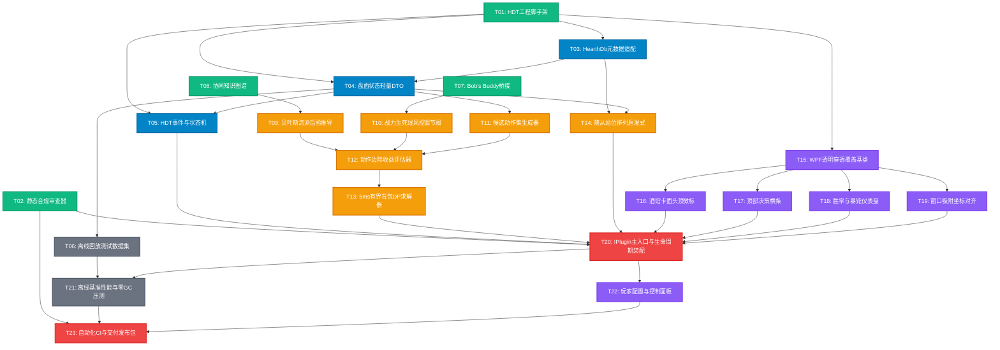

# 方案 A (HDT 插件) 全开发流程原子任务分解与有向依赖图 (DAG)

> **文档定位**：本文档将 TavernOracle（方案 A · C# HDT 插件）的完整研发流程拆解为**相互正交、不可拆分的原子任务单元**。每个任务具备明确的输入契约、输出物与可验证验收标准。通过前置依赖有向图（DAG），开发团队可清晰判断任意时刻各任务的就绪状态（Ready to Start）并支持最大化并行开发。

---

## 1. 原子任务总览与分层定义

全项目共拆解为 **23 个原子任务**，分布于 6 个独立工程层级：
- **P0 基础环境与合规审查层 (Foundation & Compliance)**：`T01` ~ `T02`
- **P1 数据摄取与状态机层 (Data Layer & State Machine)**：`T03` ~ `T06`
- **P2 先验知识与战力仿真层 (Priors & Simulation Bridge)**：`T07` ~ `T09`
- **P3 决策大脑核心算法层 (Decision Brain Core)**：`T10` ~ `T14`
- **P4 表现层透明 HUD 控件 (Presentation Layer & HUD)**：`T15` ~ `T19`
- **P5 插件集成、压测与发布层 (Integration & Delivery)**：`T20` ~ `T23`

---

## 2. 原子任务清单详述 (Task Specification Table)

| 任务编号 | 任务名称 | 归属模块 | 前置依赖 (Prerequisites) | 任务职责与输出契约 | 验收标准 (Acceptance Criteria) |
| :--- | :--- | :--- | :--- | :--- | :--- |
| **`T01`** | HDT 插件工程脚手架搭建 | 基础工程 | **无 (根任务)** | 初始化 .NET 8 / .NET Framework 类库工程，配置对 `HearthstoneDeckTracker.exe` 与 `HearthDb.dll` 的引用；配置 Post-Build 自动拷贝 DLL 至 HDT `Plugins/` 目录。 | HDT 启动时能在“选项-插件”列表中识别到空白的 TavernOracle 插件条目，无报错加载。 |
| **`T02`** | 静态合规审查规则器 | 合规安全 | **无 (根任务)** | 编写 Roslyn Analyzer 或 CI 静态检查脚本，对工程代码进行 AST 扫描，禁止引用 `user32.dll!SendInput`、`mouse_event`、`SendKeys`、`OpenProcess` 等模拟操作与注入 API。 | 尝试引入模拟点击或驱动调用时，构建立即失败（Build Failure）并给出合规警报。 |
| **`T03`** | HearthDb 元数据适配封装 | 数据层 | `T01` | 封装 `HearthDb.Cards.All`，提取酒馆战棋随从星级、种族、基础身材、嘲讽/圣盾/剧毒/复生/磁力机制标签，以及普通与金色卡牌的三连对应映射。 | 单元测试能通过 CardID 准确检索全量战棋随从的属性与三连映射，查询耗时 $\le 0.1\text{ ms}$。 |
| **`T04`** | 盘面状态轻量 DTO 与快照定义 | 数据层 | `T01`, `T03` | 定义 `BoardSnapshot`, `MinionEntity`, `HandEntity`, `TavernMinion`, `TavernTier`, `GoldBudget` 等只读数据结构，采用值类型（Struct）与内存复用设计。 | 结构体无堆内存分配垃圾，支持深度拷贝与不可变快照隔离。 |
| **`T05`** | HDT 游戏事件转换与状态机 | 数据层 | `T01`, `T04` | 监听 HDT `GameEvents.OnGameStart`, `OnTurnStart`, `OnEntityCreated`, `OnZoneChange`，将 HDT `Core.Game` 实体转换为内部统一的 `BoardSnapshot`。 | 当局势发生变化（买怪、刷新、打出）时，状态机能在 $\le 2\text{ ms}$ 内产出当前盘面不可变快照。 |
| **`T06`** | 离线盘面对局回放测试数据集 | 数据测试 | `T04` | 录制或手工编写典型战局样本集（如跳蛙野兽流转折点、残血紧急苟活、神仙决赛圈等至少 20 组盘面快照 JSON 文件），供算法离线脱机调试。 | 单元测试工程可在完全不启动炉石和 HDT 的脱机环境下快速加载盘面快照。 |
| **`T07`** | Bob's Buddy 战力模拟桥接适配器 | 战力仿真 | **无 (根任务)** | 编写对 HDT 内置 `BobsBuddyInvoker` 的访问包装类，当战斗结束或回合切换时提取下一场预测暴毙率 $P_{\text{lethal}}$ 与平局/胜率浮点值。 | 在 HDT 运行环境下能正常接收 Bob's Buddy 的对战模拟结果；脱机模式下优雅降级使用默认安全值（$P_{\text{lethal}} = 0.10$）。 |
| **`T08`** | 流派构筑与种族协同知识图谱 | 先验知识 | **无 (根任务)** | 编写 `archetypes.json` 规则库，定义各大流派（跳蛙野兽、偏折机械、手牌鱼人、亡灵复生等）的核心发动机随从 ID、协同收益矩阵与种族位掩码（BitMask）。 | 验证 JSON 格式合法，且各大主流流派的核心组件完备定义，无无效 CardID。 |
| **`T09`** | 贝叶斯流派后验概率推导器 | 算法层 | `T08` | 输入当前英雄 $H$、禁选种族池 $B$ 以及场上手牌已有组件 $C$，按公式 $P(\text{流派}_k \mid H, C, B) \propto P(C \mid \text{流派}_k) \cdot P(\text{流派}_k \mid H, B)$ 推导各流派概率分布。 | 单元测试验证：场上有跳蛙与瑞文戴尔时，野兽流后验概率显著提升至 $\ge 80\%$；推导耗时 $\le 0.5\text{ ms}$。 |
| **`T10`** | 战力生死线风控调节阀 | 算法层 | `T07` | 实现保命权重 $w_{\text{tempo}} = 1.0 + 3.0 \cdot P_{\text{lethal}}^2$ 与远期贪婪权重 $w_{\text{scale}} = \max(0, 1.0 - 0.9 \cdot P_{\text{lethal}})$ 动态调节；当 $P_{\text{lethal}} > 30\%$ 触发策略突变切断贪婪逻辑。 | 单元测试通过边界值验证：在 $P_{\text{lethal}} = 0.05$ 时保持贪婪升本；在 $P_{\text{lethal}} = 0.40$ 时贪婪权重强制归零。 |
| **`T11`** | 原子操作候选动作集生成器 | 算法层 | `T04` | 根据当前酒馆在售随从、手牌与战场 7 个卡位，生成当前回合所有合法原子动作分支：`BUY(id)`, `SELL(slot)`, `REROLL`, `FREEZE`, `UPGRADE_TIER`, `PLAY(slot, pos)`。 | 生成的候选动作不包含非法行为（如卡位已满仍生成买入非战吼怪、金币不足仍升本等），生成耗时 $\le 0.5\text{ ms}$。 |
| **`T12`** | 动作边际收益价值评估器 | 算法层 | `T09`, `T10`, `T11` | 实现边际收益公式 $\Delta V(a) = w_{\text{tempo}} \cdot \Delta\text{战力} + w_{\text{scale}} \cdot \Delta\text{协同} + \text{对子加成}$，对单一动作增量打分。 | 面对对子牌时能给出额外的对子加权分；面对高协同质变怪能给出协同加权；打分耗时 $\le 1\text{ ms}$。 |
| **`T13`** | 分支定界有界背包 DP 求解器 | 算法层 | `T12` | 在可用铸币与 7 卡位双重约束下，对动作树执行分支定界剪枝搜索，输出全局评分最高的最优操作序列；设置 $4.5\text{ ms}$ 硬超时保底机制。 | 在极端复杂局面（10 金币、满手牌、多对子）下搜索全流程耗时严格控制在 $\le 5\text{ ms}$ 内，且不产生堆内存 GC。 |
| **`T14`** | 随从站位排列启发式排序器 | 算法层 | `T03`, `T04` | 根据场上 7 个随从的嘲讽、风怒、圣盾、破盾怪、亡语触发顺序及防狂战斧规则，输出最优站位坐标序列。 | 能够自动将圣盾狂战斧排在首位、嘲讽圣盾靠右、关键后排发动机（瑞文/铜须）置于最右侧防狂战斧波及。 |
| **`T15`** | WPF 透明点击穿透覆盖层基类 | 表现层 | `T01` | 实现挂载至 HDT `Core.OverlayCanvas` 的自定义 WPF 控件；调用 Win32 API 设置 `WS_EX_TRANSPARENT \| WS_EX_LAYERED` 样式。 | 鼠标在悬浮窗区域进行高频拖拽、点击出牌，游戏原生点击操作 100% 畅通无阻，绝不丢牌卡手。 |
| **`T16`** | 酒馆卡面头顶微标控件 (Badge) | 表现层 | `T15` | 开发卡面上浮动态推荐微标（🔥【三连对子】、★【流派质变怪】、🛡️【即时保命单卡】）；支持平滑浮现与呼吸动效。 | 微标在随从正上方精准对齐，无文本溢出或视觉遮挡卡牌身材（攻防数值）。 |
| **`T17`** | 顶部决策横条控件 (Banner) | 表现层 | `T15` | 开发屏幕顶部半透明大局策略横条，展示本回合核心战略（如“升至 4 本并冻结跳蛙”、“切勿刷新，存铸币防暴毙”）。 | 文本自适应缩放排版，支持根据危险程度呈现绿、黄、红三种视觉警示状态。 |
| **`T18`** | 胜率与暴毙概率仪表盘 (Gauge) | 表现层 | `T15` | 开发轻量级暴毙预警仪，实时渲染预测胜率、打平率与暴毙率百分比与动态颜色警示条。 | 随战力模拟输出动态刷新，帧率稳定，GPU 绘制占用趋近于 0。 |
| **`T19`** | 游戏窗口吸附与坐标变换对齐 | 表现层 | `T15` | 监听 HDT 窗口吸附通知与 Win32 `WM_MOVE`、`WM_SIZE`，在窗口化、全屏及系统 DPI 缩放（100%、125%、150%）下保持卡面像素级对齐。 | 在拖动炉石游戏窗口或改变分辨率时，微标与横条实时跟随吸附，偏移误差 $< 2\text{ px}$。 |
| **`T20`** | HDT IPlugin 主入口与生命周期装配 | 系统集成 | `T02`, `T05`, `T13`, `T14`, `T16`, `T17`, `T18`, `T19` | 实现 `IPlugin` 接口全部生命周期（`OnLoad`, `OnUpdate`, `OnUnload`），串联事件总线、算法引擎与表现层，组装核心链路。 | 在完整对局中从选英雄、进酒馆、打对战直至游戏结束，全流程零异常崩溃（Zero Unhandled Exceptions）。 |
| **`T21`** | 离线基准性能与零 GC 压测套件 | 质量验证 | `T06`, `T20` | 基于 `T06` 的 20 组对局快照批量循环运行 10,000 次，利用 BenchmarkDotNet 统计 P99 决策耗时与 Gen0/1/2 垃圾回收次数。 | 决策链路平均耗时 $\le 3.5\text{ ms}$，P99 耗时 $\le 4.8\text{ ms}$，每千次推理产生的 GC 内存分配为 0 字节（Zero GC Allocation）。 |
| **`T22`** | 玩家个性化配置与快捷控制面板 | 用户体验 | `T20` | 在 HDT 插件设置界面嵌入配置项：HUD 整体开关、推荐激进/保守度调节滑块、各组件可见性勾选。 | 修改配置后实时生效，设置持久化存储于本地 XML/JSON 配置文件中。 |
| **`T23`** | 自动化构建流水线与版本交付包 | 工程发布 | `T02`, `T21`, `T22` | 编写 GitHub Actions / 本地 MSBuild 脚本，执行合规静态审查、跑通全部单测与压测，编译并压缩打包最终交付物 `TavernOracle-v1.0.0.zip`。 | 一键构建生成符合 HDT 插件发布规范的 Zip 包，解压至 `Plugins/` 目录即刻开箱即用。 |

---

## 3. 依赖关系有向图 (Directed Acyclic Graph)

以下 Mermaid 图表定义了全流程任务的先后依赖拓扑。
> **图示规则**：箭头 $A \longrightarrow B$ 代表 **任务 A 是任务 B 的必要前置条件**。只有当指向任务 B 的所有前置任务全部完工后，任务 B 方可进入开发就绪状态。

---

## 4. 任务开工就绪状态判定表 (Ready-to-Start Analysis)

依据 DAG 的入度（In-degree）计算，任务就绪状态动态推导如下：

### 4.1 第一梯队：无任何前置依赖（入度为 0，可立即开工）
以下 4 个任务互不干扰，可由不同开发者在 **Day 1 并行开工**：
- 🟢 **`T01` (HDT 插件工程脚手架搭建)**：建立类库，跑通本地构建与 DLL 导出。
- 🟢 **`T02` (静态合规审查规则器)**：配置代码禁止名单扫描，构筑防封号红线。
- 🟢 **`T07` (Bob's Buddy 战力模拟桥接适配器)**：研究 HDT 战棋模拟器调用契约与降级封装。
- 🟢 **`T08` (流派构筑与种族协同知识图谱)**：纯 JSON/元数据编写，梳理当前版本流派与核心卡。

### 4.2 第二梯队：依赖第一梯队输出物（`T01` 或 `T08` 完成后解锁）
- 🟡 **`T03`**：在 `T01` 完成后即可开工，封装 `HearthDb`。
- 🟡 **`T09`**：在 `T08` 编写完成后即可开工，实现贝叶斯公式计算。
- 🟡 **`T10`**：在 `T07` 桥接封装后即可开工，实现权重调节阀。
- 🟡 **`T15`**：在 `T01` 类库创建完成后即可开工，编写 WPF 穿透窗体。

### 4.3 核心关键路径 (Critical Path)
决定整个项目最短交付周期的关键路径如下：
$$\mathbf{T01} \longrightarrow \mathbf{T03} \longrightarrow \mathbf{T04} \longrightarrow \mathbf{T11} \longrightarrow \mathbf{T12} \longrightarrow \mathbf{T13} \longrightarrow \mathbf{T20} \longrightarrow \mathbf{T21} \longrightarrow \mathbf{T23}$$
该路径覆盖了从脚手架、数据模型、动作空间、边际价值、背包 DP 搜索到集成压测发布的核心算法主干线，累计 9 级串行依赖。任何处于该路径上的任务延误，都将直接推迟项目的最终交付时间。
